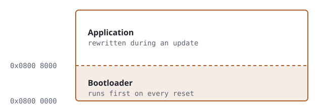

This file is a reference, not an article. It shows every feature the blog
supports. Because of `draft: true` it only appears when you run
`hugo server -D`, never on the live site.

## Start a new article

From the `blog` folder:

```bash
hugo new content posts/my-article/index.md
```

That creates `content/posts/my-article/index.md` with the front matter filled
in. Put images for that article in the same folder. Set `draft: false` when
it's ready, commit, push, and Netlify publishes it.

## Code

Fenced blocks get syntax colours. Name the language after the backticks:

```c
#define APP_BASE  0x08008000u

typedef void (*reset_handler_t)(void);

static void jump_to_app(void)
{
    uint32_t sp    = *(volatile uint32_t *)(APP_BASE);
    uint32_t entry = *(volatile uint32_t *)(APP_BASE + 4u);

    __disable_irq();
    SCB->VTOR = APP_BASE;          /* vector table now points at the app */
    __set_MSP(sp);
    ((reset_handler_t)entry)();    /* never returns */
}
```

Inline code works too: `HAL_UART_Receive_DMA()`.

Assembly and shell work the same way (`asm`, `bash`, `python`, `cpp`, `make`, …):

```asm
    ldr   r0, =0x08008000
    ldr   sp, [r0]
    ldr   pc, [r0, #4]
```

## Figures

A standalone image becomes a numbered figure. The text in quotes becomes the caption:



Numbering is automatic: the next image would be Fig. 2.

## Footnotes

Write a marker like this[^1] and the note itself anywhere below.
They collect at the end of the article with a link back.

[^1]: Footnotes are good for datasheet references, e.g. RM0090 §3.4.

## Tables

| Bus      | Wires | Typical speed |
|----------|-------|---------------|
| UART     | 2     | 115200 baud   |
| I2C      | 2     | 400 kHz       |
| SPI      | 4     | tens of MHz   |

## Quotes and notes

> Read the errata sheet before you blame your code.

## Long articles

Set `toc: true` in the front matter to get a contents box at the top, like this one.
